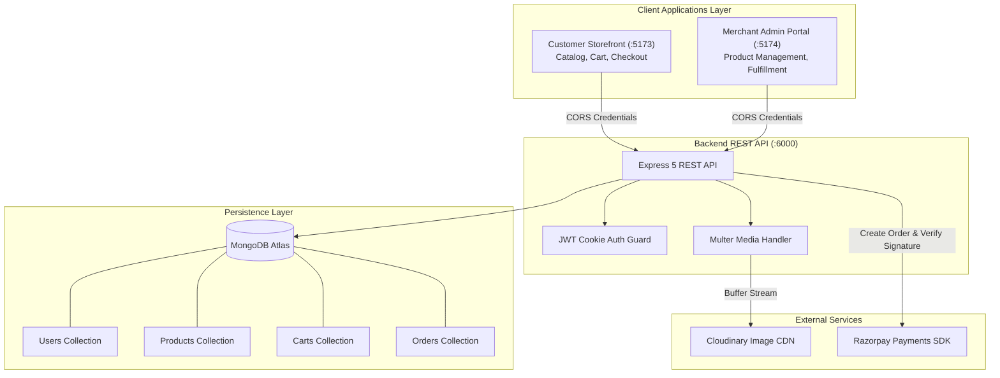

# OneCart.ai

> Full-stack e-commerce platform and merchant administration portal featuring Cloudinary asset pipelines, Razorpay payment processing, and a dual-client React architecture.

[](https://react.dev/)
[](https://nodejs.org/)
[](https://expressjs.com/)
[](https://www.mongodb.com/)
[](https://cloudinary.com/)
[](https://razorpay.com/)
[](https://tailwindcss.com/)

---

## Overview

I built this project to implement an end-to-end commercial store architecture:
- **Dual-Client Architecture**: Decoupling the customer storefront (`frontend`) from the merchant management portal (`admin`).
- **Payment Verification**: Integrating Razorpay checkout workflows, order receipt generation, and backend signature verification.
- **Media Pipeline**: Handling multipart product image uploads via Multer and streaming to Cloudinary CDN.
- **Persistent Cart & Orders**: Managing authenticated cart sessions, address records, and order fulfillment states in MongoDB.

---

## Identity

<div align="center">
  
</div>

---

## Architecture



---

## Key Features

- **Storefront**: Product filtering by category and price, global `ShopContext` cart state, and dual payment support (Cash on Delivery and Razorpay).
- **Merchant Admin**: Product creation with multi-image Cloudinary uploads, and an order fulfillment pipeline (`Order Placed` -> `Packing` -> `Shipped` -> `Delivered`).
- **Backend Security**: Express 5 with ES Modules, stateless JWT authentication in HttpOnly cookies, and input validation via `validator`.

---

## Directory Structure

| Folder | Role | Port | Tech Stack |
| :--- | :--- | :--- | :--- |
| `frontend/` | Customer Storefront | `:5173` | React 18, Vite, Tailwind CSS, Context API |
| `admin/` | Merchant Portal | `:5174` | React 18, Vite, Tailwind CSS, Axios |
| `backend/` | Central REST API | `:6000` | Node.js, Express 5, Mongoose, Razorpay, Cloudinary |

---

## Setup & Local Run

### Prerequisites
- Node.js 20+
- MongoDB instance (local or Atlas)
- Cloudinary & Razorpay credentials

### 1. Install Dependencies
```bash
git clone https://github.com/V-Rytham/OneCart.ai.git
cd OneCart.ai

npm install --prefix backend
npm install --prefix frontend
npm install --prefix admin
```

### 2. Environment Variables
Create `.env` in `backend/`:
```ini
PORT=6000
MONGODB_URI=your_mongodb_uri
JWT_SECRET=your_jwt_secret
CLOUDINARY_NAME=your_cloudinary_name
CLOUDINARY_API_KEY=your_cloudinary_key
CLOUDINARY_SECRET_KEY=your_cloudinary_secret
RAZORPAY_KEY_ID=your_razorpay_key
RAZORPAY_KEY_SECRET=your_razorpay_secret
```

Create `.env` in `frontend/` and `admin/`:
```ini
VITE_BACKEND_URL=http://localhost:6000
```

### 3. Start Development Servers
```bash
npm run dev --prefix backend
npm run dev --prefix frontend
npm run dev --prefix admin
```

- Storefront: `http://localhost:5173`
- Admin Portal: `http://localhost:5174`
- API: `http://localhost:6000`
